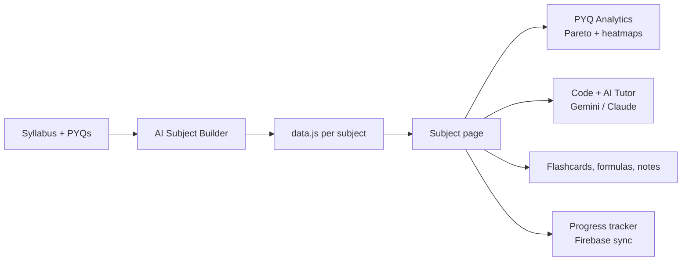

<!-- ANIMATED WAVE BANNER -->

<!-- TYPING ANIMATION -->

  

<!-- LIVE PRODUCT LINKS -->

  

---

## 👋 Hi, I'm Dharaksh

I'm a **Computer Science & Engineering** student at **SRM Institute of Science and Technology** who builds the tools I wished existed during exam season. I spot a real bottleneck for students and developers (scattered notes, rote memorization, repetitive content work), then ship a product that fixes it.

My work blends **CS fundamentals** (C, C++, Python, Java) with **full-stack engineering**, **data-driven exam analytics**, **in-browser code execution** and **LLM integrations** (Google Gemini and Anthropic Claude).

---

## 📊 By the Numbers

<table>
  <tr>
    <td align="center" width="16%"><h2>6</h2><b>Live Products</b></td>
    <td align="center" width="16%"><h2>67</h2><b>Subjects Indexed</b></td>
    <td align="center" width="16%"><h2>6</h2><b>Semesters Covered</b></td>
    <td align="center" width="16%"><h2>8 yrs</h2><b>PYQs Analyzed</b></td>
    <td align="center" width="16%"><h2>100+</h2><b>C++ Code Examples</b></td>
    <td align="center" width="16%"><h2>24</h2><b>UI Themes</b></td>
  </tr>
</table>

---

## 🚀 Featured Projects

### 1. SRM Smart Study Hub — Full-Syllabus Academic Portal

<table>
  <tr>
    <td width="68%" valign="top">
      
<b>Live:</b> <a href="https://www.srmedu.in/">srmedu.in</a> &nbsp;|&nbsp; <b>Source:</b> <kbd>Private production repo</kbd>

      
<b>Problem:</b> Syllabi, notes, formula sheets and PYQs live in scattered folders and chat groups, so students don't know which topics carry the marks.

      
<b>Solution:</b> A student-run academic companion for SRM IST covering <b>67 subjects across 6 semesters</b> (CSE, ECE/PCB, Mechanical, Biotech, 6 foreign languages), unified in one data-driven workspace.

      <ul>
        <li>📊 <b>Pareto PYQ analytics:</b> up to 8 years of papers turned into unit weightage, topic-frequency heatmaps, Part A/B/C strategy and predicted topics (e.g. <i>Computer Networks 21CSC302J</i>, <i>UHV 22CLA101</i>).</li>
        <li>🤖 <b>Code + AI workspace:</b> embedded compiler plus a dual-LLM tutor (Gemini and Claude) with MCQ, 5-Mark, Exam Q and Viva modes.</li>
        <li>🧠 <b>Active recall suite:</b> MCQ flashcards with live scoring, PYQ viewer, searchable formula sheets, CGPA calculator, per-topic notes.</li>
        <li>☁️ <b>Sync and builder:</b> Google Drive document sync, Firebase-backed progress tracking, and an AI "Add Subject" generator that turns a syllabus into a <code>data.js</code> dataset.</li>
        <li>📴 <b>Offline-first PWA:</b> service worker caching so notes survive campus network drops.</li>
        <li>🎨 <b>24-theme UI engine:</b> Dark Academia, Nord Frost, Dracula, Monokai Pro, OLED Pure Black and more, persisted across visits.</li>
      </ul>
    </td>
    <td width="32%" valign="top">
      <h4>Stack</h4>
      

        
        
        
      

      <ul>
        <li>HTML5, CSS3, JavaScript (ES6+)</li>
        <li>Modular <code>data.js</code> per subject</li>
        <li>Gemini + Claude APIs</li>
        <li>Firebase Auth + Firestore</li>
        <li>Service Workers (PWA)</li>
        <li>Google Drive sync</li>
        <li>Custom DNS, Google Analytics</li>
      </ul>
      

        
      

    </td>
  </tr>
</table>

<i>Independent student-run initiative; not officially endorsed by SRM IST.</i>

  
<b>📂 How the Hub is structured (architecture + semester coverage)</b>

   

| Semester | Subjects | Representative courses |
| :--- | :---: | :--- |
| **1** | 20 | Programming for Problem Solving (C), Calculus & Linear Algebra, Engineering Chemistry, Computational Biology, 6 foreign languages |
| **2** | 10 | OOPS, Advanced Calculus, Electronic System & PCB Design, Semiconductor Physics, Basic EEE |
| **3** | 16 | DSA, Operating Systems, COA, Core Java, Digital Logic Design, Foundation of Data Science, UHV |
| **4** | 14 | DAA, DBMS, AI, Computer Graphics, IoT, Probability & Queueing Theory, Digital Image Processing |
| **5** | 4 | Computer Networks, Full Stack Web Development, FLA, Discrete Mathematics |
| **6** | 3 | Compiler Design, Software Engineering & Project Management, Data Science |

---

### 2. ProjectMatch — AI-Powered Team Formation Platform

<table>
  <tr>
    <td width="68%" valign="top">
      
<b>Live:</b> <a href="https://projectmatch-phi.vercel.app/">projectmatch-phi.vercel.app</a> &nbsp;|&nbsp; <b>Repo:</b> <a href="https://github.com/dharaksh2807-svg/projectmatch"><code>dharaksh2807-svg/projectmatch</code></a>

      
<b>Problem:</b> Hackathon and project teams form around social circles, not skills.

      
<b>Solution:</b> A full-stack platform that matches builders, designers and researchers by verified skill gaps, availability and timezone.

      <ul>
        <li>🎯 <b>Weighted matchmaking engine:</b> scores compatibility across skills, experience, availability and interests for each open role.</li>
        <li>🤖 <b>Dual AI agents:</b> Gemini and Claude SDKs, per-user AES-encrypted API keys, custom agent prompts, plus a head-to-head <b>PromptBattle</b> voting arena.</li>
        <li>🗄️ <b>15+ relational models</b> in Prisma + PostgreSQL: users, role bookmarks, peer reviews, reputation, messaging.</li>
        <li>📍 <b>Campus-aware filters</b> for local in-person team formation (SRM IST, Chennai).</li>
        <li>🧪 <b>Tested:</b> Playwright for end-to-end flows, Vitest for logic and components.</li>
      </ul>
    </td>
    <td width="32%" valign="top">
      <h4>Stack</h4>
      <ul>
        <li>Next.js 15 (App Router), React 19</li>
        <li>TypeScript, Tailwind CSS</li>
        <li>Prisma ORM + PostgreSQL</li>
        <li>NextAuth.js, Tiptap Editor</li>
        <li>Gemini + Claude SDKs</li>
        <li>Vitest, Playwright</li>
      </ul>
      

        
      

    </td>
  </tr>
</table>

---

### 3. OODP Mastery — 12-Layer Interactive C++ & OOP System

<table>
  <tr>
    <td width="68%" valign="top">
      
<b>Live:</b> <a href="https://oops-mastery.netlify.app/">oops-mastery.netlify.app</a> &nbsp;|&nbsp; <b>Showcase repo:</b> <a href="https://github.com/dharaksh2807-svg/oops-mastery."><code>oops-mastery.</code></a>

      
<b>Problem:</b> Students can recite OOP definitions but can't write C++ independently or trace what happens in memory.

      
<b>Solution:</b> <b>5 units, 30+ topics, 100+ runnable examples</b>, built for retention and exam mastery.

      <ul>
        <li>🏗️ <b>12 layers per topic:</b> analogy, theory, memory and runtime mechanics, basic-to-tricky code, dry runs, common mistakes, decision frameworks, connections, 3-level practice, mnemonics, 2/5/10/15-mark prep, 1-minute revision sheet.</li>
        <li>🔍 <b>Runtime internals:</b> VTable dispatch, virtual destructors, Diamond Problem, template instantiation, stack unwinding, <code>vector</code> reallocation vs Red-Black Tree <code>set</code>/<code>map</code>.</li>
        <li>💻 <b>Split-screen compiler + AI assistant</b> for running and debugging every example in the browser.</li>
        <li>🚨 <b>Last-Nighter guide + 49 solved PYQs:</b> compiler-trap cheat sheet, "Predict the Output" drills, UML diagrams, Hinglish explanations.</li>
      </ul>
    </td>
    <td width="32%" valign="top">
      <h4>Stack</h4>
      

        
        
        
      

      <ul>
        <li>C++ (OOP, templates, exceptions, STL)</li>
        <li>UML class + sequence diagrams</li>
        <li>HTML5, CSS3, JavaScript</li>
        <li>Embedded C++ compiler + AI assistant</li>
        <li>Netlify</li>
      </ul>
      

        
      

    </td>
  </tr>
</table>

  
<b>📂 The 5 curriculum units</b>

   

| Unit | Focus |
| :---: | :--- |
| **1** | OOAD, the 4 pillars, classes & objects, access specifiers, UML class diagrams |
| **2** | Constructors (default, parameterized, copy), destructors, operator and function overloading, virtual functions, UML sequence diagrams |
| **3** | All inheritance types, constructor/destructor chains, Diamond Problem, VTable dispatch, pure virtual functions, abstract classes |
| **4** | Function and class templates, specialization, `try`/`catch`/`throw`, stack unwinding, exception safety |
| **5** | STL containers, iterators, functors, algorithms, complexity analysis |

---

### 4. LinkedInPostPro — Satirical Tone Translator

<table>
  <tr>
    <td width="68%" valign="top">
      
<b>Live:</b> <a href="https://linkedinpostpro.vercel.app/">linkedinpostpro.vercel.app</a> &nbsp;|&nbsp; <b>Showcase repo:</b> <a href="https://github.com/dharaksh2807-svg/linkedinpost."><code>linkedinpost.</code></a>

      
A satirical single-page app exploring LLM tone transformation and prompt engineering: it turns honest, everyday statements into buzzword-packed LinkedIn posts.

      <ul>
        <li>⚡ <b>Zero friction:</b> no API key required from visitors.</li>
        <li>🧩 <b>Context-aware prompts:</b> optional degree or job title enriches the output.</li>
        <li>⌨️ <b>Dual-pane UI</b> with <kbd>Ctrl</kbd>/<kbd>⌘</kbd> + <kbd>Enter</kbd> and one-click copy.</li>
      </ul>
    </td>
    <td width="32%" valign="top">
      <h4>Stack</h4>
      <ul>
        <li>Next.js 15, React 19</li>
        <li>Tailwind CSS</li>
        <li>Vercel</li>
      </ul>
      

        
      

    </td>
  </tr>
</table>

---

## ✨ More Builds

<table>
  <tr>
    <td width="50%" valign="top">
      <h4>♻️ ReValue — Circular Economy Operating System</h4>
      
<b>Live:</b> <a href="https://revalue-gray.vercel.app/">revalue-gray.vercel.app</a>

      
An AI-powered operating system for the circular economy.

      <!-- TODO: add 2-3 feature bullets and the tech stack here -->
      

        
      

    </td>
    <td width="50%" valign="top">
      <h4>🕊️ Micchami Dukkadam — Interactive Greeting</h4>
      
<b>Live:</b> <a href="https://micchami-dukkadam.vercel.app/">micchami-dukkadam.vercel.app</a>

      
A shareable, story-style greeting experience for Paryushana and Samvatsari.

      <ul>
        <li>🎨 Animated intro with a scroll-through story</li>
        <li>🎵 Navkar Mantra with a play-chant audio player</li>
        <li>🖼️ Gallery of the 24 Tirthankaras with their symbols</li>
        <li>🔗 Personalized links: add a name, copy, share via WhatsApp</li>
      </ul>
      

        
      

    </td>
  </tr>
</table>

---

## 💻 Tech Stack

**Academic foundations** · *studied in coursework, applied in my study platforms*

**Frontend**

**Backend & data**

**Testing, deployment & tools**

**AI integration**

---

## 🔥 GitHub Activity

<!-- SNAKE: needs .github/workflows/snake.yml (see setup notes) -->
<picture>
  <source media="(prefers-color-scheme: dark)" srcset="https://raw.githubusercontent.com/dharaksh2807-svg/dharaksh2807-svg/output/github-snake-dark.svg" />
  <source media="(prefers-color-scheme: light)" srcset="https://raw.githubusercontent.com/dharaksh2807-svg/dharaksh2807-svg/output/github-snake.svg" />
  
</picture>

---

## 🤝 Let's Connect

I'm open to hackathon collaborations, EdTech and AI-tooling conversations, and software engineering opportunities.

| Platform | Link | What it is |
| :--- | :--- | :--- |
| 🌐 **SRM Smart Study Hub** | [srmedu.in](https://www.srmedu.in/) | 67-subject academic portal, PYQ heatmaps, AI tutor |
| 🤝 **ProjectMatch** | [projectmatch-phi.vercel.app](https://projectmatch-phi.vercel.app/) | AI-powered team formation |
| 🧠 **OODP Mastery** | [oops-mastery.netlify.app](https://oops-mastery.netlify.app/) | 12-layer C++, STL and OOP platform |
| ✍️ **LinkedInPostPro** | [linkedinpostpro.vercel.app](https://linkedinpostpro.vercel.app/) | Satirical LinkedIn tone translator |
| ♻️ **ReValue** | [revalue-gray.vercel.app](https://revalue-gray.vercel.app/) | AI-powered circular economy OS |
| 🕊️ **Micchami Dukkadam** | [micchami-dukkadam.vercel.app](https://micchami-dukkadam.vercel.app/) | Shareable interactive greeting experience |
| 💻 **GitHub** | [@dharaksh2807-svg](https://github.com/dharaksh2807-svg) | Repositories and ongoing work |
| 📫 **Email** | [srmeduhelp@gmail.com](mailto:srmeduhelp@gmail.com) | Feedback, collaboration, inquiries |

 

> *"Good software turns confusion into clarity — whether that means decoding six semesters of coursework or visualizing what a C++ compiler does in memory."*

